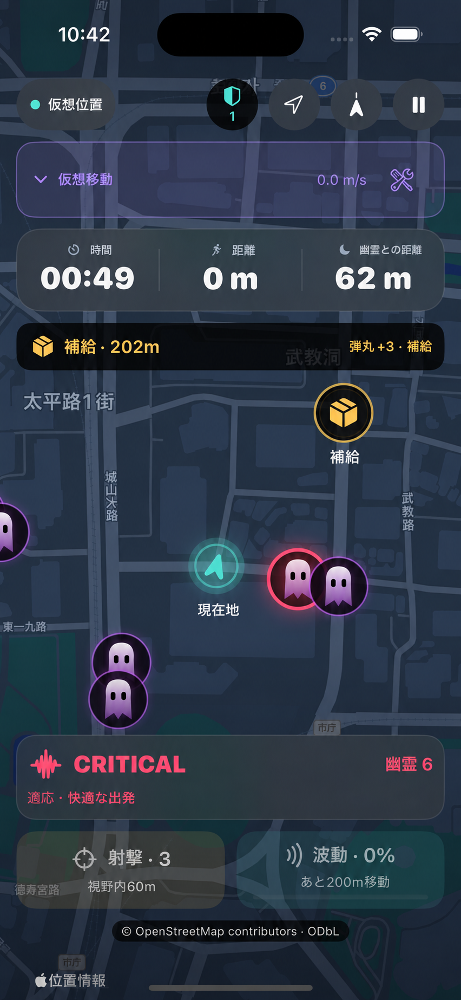

# GHOST RUN

[日本語](README.ja.md) · [English](README.md) · [한국어](README.ko.md)

**ゴーストラン**は、現実を歩き回る動きをゲームプレイに変えるiOSランニングゲームのプロトタイプです。

幽霊がプレイヤーを追いかけ、プレイヤーは画面の中のキャラクターではなく実際に動いて距離を広げなければなりません。

## ゲームコンセプト

- 実際の位置移動がゲーム内移動として反映されます。
- 準備時間が終わると、周囲にゴーストが表示されます。
- 停止または遅すぎると、ゴーストが近づきます。
- 普及地まで実際に移動すると生存に役立つ資源を得ます。
- 生存時間と移動距離がスコアとして記録されます。

## 目標

ゴーストランの目標は、運動を無理にするアプリではなく、ゲームの緊張感と報酬を通じて、ユーザーが自然にもう少し歩いて走る経験を作ることです。

## 技術

- Swift
- SwiftUI
- MapKit
- CoreLocation
- iOS 17+

## 安全案内

実際の屋外で使用するゲームなので、周辺環境、交通、出入り制限エリアを常に優先する必要があります。画面を見ながら走る行動は危険であり、安全な場所でのみプレイする必要があります。
