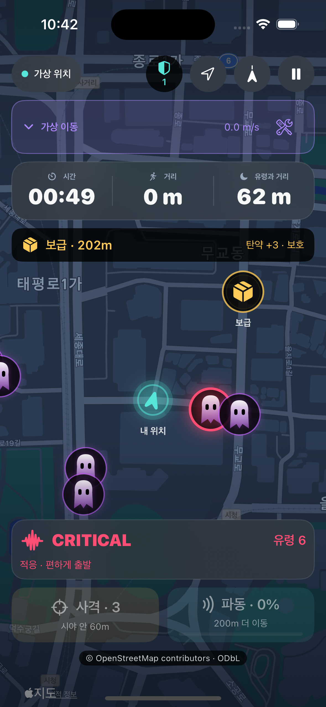

# GHOST RUN

[日本語](https://github.com/hjy0221/ghost-run#%E6%97%A5%E6%9C%AC%E8%AA%9E) · [English](https://github.com/hjy0221/ghost-run#english) · [한국어](https://github.com/hjy0221/ghost-run#%ED%95%9C%EA%B5%AD%EC%96%B4)

## 日本語

GHOST RUN は、現実の歩行やランニングをゲームプレイに変える iOS ランニングゲームのプロトタイプです。プレイヤーは実際に移動して追いかけてくるゴーストとの距離を広げます。

### ゲームの内容

- 現実の位置移動をゲームに反映します。
- 準備時間後にゴーストが現れ、停止や減速で近づきます。
- 現実の補給地点に到達すると生存に役立つ資源を得られます。
- 生存時間と移動距離がスコアになります。

ゲームの緊張感と報酬を通じて、自然に歩いたり走ったりする体験を目指しています。Swift、SwiftUI、MapKit、CoreLocation、iOS 17 以降を使用します。

### 安全について

屋外では周囲の状況、交通、立入禁止区域を優先してください。画面を見ながら走ることは危険なため、安全な場所でプレイしてください。

## English

GHOST RUN is an iOS running-game prototype that turns real-world walking and running into gameplay. A ghost pursues the player, who must physically move to increase the distance.

### Game concept

- Real location changes are reflected in the game.
- Ghosts appear nearby after the preparation period and move closer if the player stops or slows down too much.
- Reaching supply points in the real world provides survival resources.
- Survival time and distance traveled contribute to the score.

The goal is to encourage a little more walking and running through the tension and rewards of a game. The prototype uses Swift, SwiftUI, MapKit, CoreLocation, and iOS 17 or later.

### Safety

When playing outdoors, prioritize your surroundings, traffic, and restricted areas. Looking at a screen while running can be dangerous; play only in safe locations.

## 한국어

**고스트 런**은 현실에서 걷고 뛰는 움직임을 게임 플레이로 바꾸는 iOS 러닝 게임 프로토타입입니다.

유령이 플레이어를 쫓아오고, 플레이어는 화면 속 캐릭터가 아니라 실제로 움직여 거리를 벌려야 합니다.

## 게임 컨셉

- 실제 위치 이동이 게임 속 이동으로 반영됩니다.
- 준비 시간이 끝나면 주변에 유령이 나타납니다.
- 멈추거나 너무 느려지면 유령이 가까워집니다.
- 보급 지점까지 실제로 이동하면 생존에 도움이 되는 자원을 얻습니다.
- 생존 시간과 이동 거리가 점수로 기록됩니다.

## 목표

고스트 런의 목표는 운동을 억지로 시키는 앱이 아니라, 게임의 긴장감과 보상을 통해 사용자가 자연스럽게 조금 더 걷고 뛰게 만드는 경험을 만드는 것입니다.

## 기술

- Swift
- SwiftUI
- MapKit
- CoreLocation
- iOS 17+

## 안전 안내

실제 야외에서 사용하는 게임이므로 주변 환경, 교통, 출입 제한 구역을 항상 우선해야 합니다. 화면을 보며 달리는 행동은 위험할 수 있으며, 안전한 장소에서만 플레이해야 합니다.
