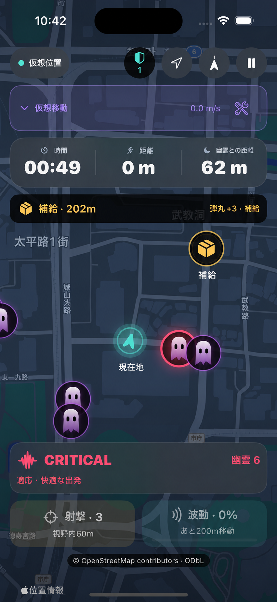
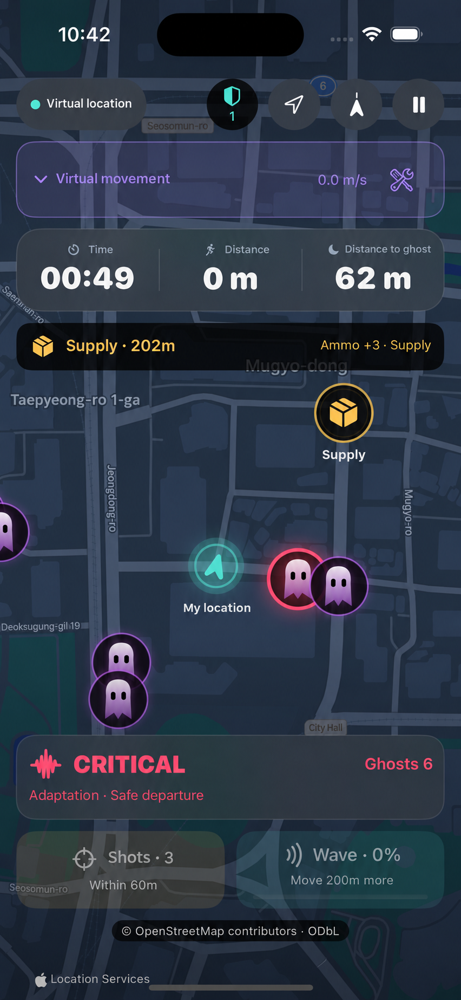

# GHOST RUN

[日本語](https://github.com/hjy0221/ghost-run#%E6%97%A5%E6%9C%AC%E8%AA%9E) · [English](https://github.com/hjy0221/ghost-run#english) · [한국어](https://github.com/hjy0221/ghost-run#%ED%95%9C%EA%B5%AD%EC%96%B4)

## 日本語

[日本語](https://github.com/hjy0221/ghost-run#%E6%97%A5%E6%9C%AC%E8%AA%9E) · [English](https://github.com/hjy0221/ghost-run#english) · [한국어](https://github.com/hjy0221/ghost-run#%ED%95%9C%EA%B5%AD%EC%96%B4)

**ゴーストラン**は、現実を歩き回る動きをゲームプレイに変えるiOSランニングゲームのプロトタイプです。

幽霊がプレイヤーを追いかけ、プレイヤーは画面の中のキャラクターではなく実際に動いて距離を広げなければなりません。

## ゲームコンセプト

- 実際の位置移動がゲーム内移動として反映されます。
- 準備時間が終わると、周囲にゴーストが表示されます。
- 停止または遅すぎると、ゴーストが近づきます。
- 普及地まで実際に移動すると生存に役立つ資源を得ます。
- 生存時間と移動距離がスコアとして記録されます。

## 目標

ゴーストランの目標は、運動を無理にするアプリではなく、ゲームの緊張感と報酬を通じて、ユーザーが自然にもう少し歩いて走る経験を作ることです。

## 技術

- Swift
- SwiftUI
- MapKit
- CoreLocation
- iOS 17+

## 安全案内

実際の屋外で使用するゲームなので、周辺環境、交通、出入り制限エリアを常に優先する必要があります。画面を見ながら走る行動は危険であり、安全な場所でのみプレイする必要があります。

## English

[日本語](https://github.com/hjy0221/ghost-run#%E6%97%A5%E6%9C%AC%E8%AA%9E) · [English](https://github.com/hjy0221/ghost-run#english) · [한국어](https://github.com/hjy0221/ghost-run#%ED%95%9C%EA%B5%AD%EC%96%B4)

**Ghost Run** is an iOS running game prototype that turns real-life walking and running movements into gameplay.

A ghost will chase the player, and the player must move to create distance between them by actually moving, rather than just a character on the screen.

## Game Concept

- Actual location movement is reflected as movement in the game.
- When the preparation time is over, a ghost will appear nearby.
- If you stop or slow down too much, the ghost will get closer.
- If you actually move to the supply point, you will get resources that will help you survive.
- Survival time and travel distance are recorded as scores.

## Goal

The goal of Ghost Run is not to create an app that forces exercise, but to create an experience that naturally encourages users to walk and run a little more through the tension and rewards of the game.

## Technology

-Swift
-SwiftUI
-MapKit
-CoreLocation
- iOS 17+

## Safety Information

Since this is a game played outdoors, surroundings, traffic, and restricted areas must always be prioritized. Running while looking at the screen can be dangerous and should only be played in safe locations.

## 한국어

[日本語](https://github.com/hjy0221/ghost-run#%E6%97%A5%E6%9C%AC%E8%AA%9E) · [English](https://github.com/hjy0221/ghost-run#english) · [한국어](https://github.com/hjy0221/ghost-run#%ED%95%9C%EA%B5%AD%EC%96%B4)

**고스트 런**은 현실에서 걷고 뛰는 움직임을 게임 플레이로 바꾸는 iOS 러닝 게임 프로토타입입니다.

유령이 플레이어를 쫓아오고, 플레이어는 화면 속 캐릭터가 아니라 실제로 움직여 거리를 벌려야 합니다.

## 게임 컨셉

- 실제 위치 이동이 게임 속 이동으로 반영됩니다.
- 준비 시간이 끝나면 주변에 유령이 나타납니다.
- 멈추거나 너무 느려지면 유령이 가까워집니다.
- 보급 지점까지 실제로 이동하면 생존에 도움이 되는 자원을 얻습니다.
- 생존 시간과 이동 거리가 점수로 기록됩니다.

## 목표

고스트 런의 목표는 운동을 억지로 시키는 앱이 아니라, 게임의 긴장감과 보상을 통해 사용자가 자연스럽게 조금 더 걷고 뛰게 만드는 경험을 만드는 것입니다.

## 기술

- Swift
- SwiftUI
- MapKit
- CoreLocation
- iOS 17+

## 안전 안내

실제 야외에서 사용하는 게임이므로 주변 환경, 교통, 출입 제한 구역을 항상 우선해야 합니다. 화면을 보며 달리는 행동은 위험할 수 있으며, 안전한 장소에서만 플레이해야 합니다.
